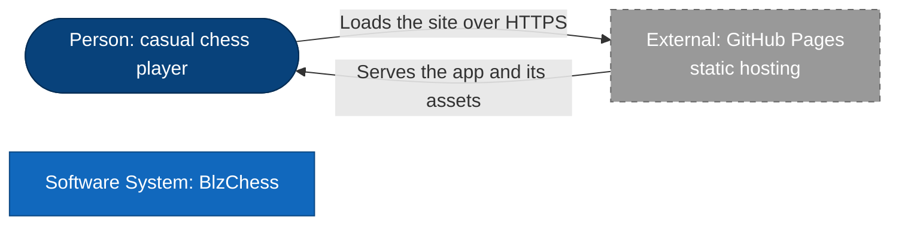
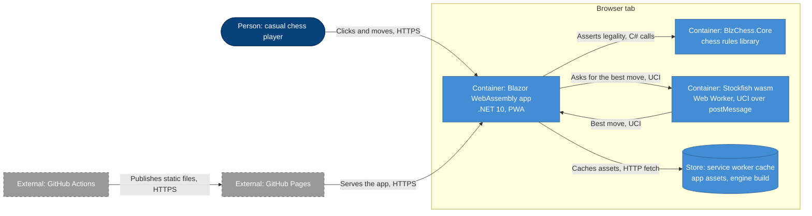

# Architecture

Last verified: 2026-11-16, at the change that made the game playable.

BlzChess is a static chess app: the browser downloads it once, caches it, and
plays without asking anyone else for anything. Why that shape was chosen is in
[`adr/0001-blazor-wasm-on-github-pages.md`](adr/0001-blazor-wasm-on-github-pages.md).

## Context

## Containers

## Legend

| Shape | C4 element |
|---|---|
| `(["..."])` | Person |
| `["..."]` | Software system, container, or external system |
| `[("...")]` | Data store |
| dashed border | External system, outside this repository's control |

## Containers

| Container | Responsibility | Path | Technology |
|---|---|---|---|
| Blazor WebAssembly app | the UI, routing, install, and the game session | `src/BlzChess.Web` | Blazor WebAssembly standalone, .NET 10, PWA service worker |
| BlzChess.Core | board state and chess rules; no UI, no browser | `src/BlzChess.Core` | C# class library, `net10.0` |
| Stockfish wasm | chooses the opponent's move | `src/BlzChess.Web/wwwroot/engine` | Stockfish 19 compiled to WebAssembly, lite network, single-threaded, in a Web Worker |
| Service worker cache | makes a repeat visit and offline play work | `src/BlzChess.Web/wwwroot/service-worker.published.js` | browser Cache Storage |
| CI | builds and tests every push | `.github/workflows/ci.yml` | GitHub Actions, `ubuntu-latest` |
| Deploy | publishes the site from `main` | `.github/workflows/deploy.yml` | GitHub Actions Pages deployment |

Hosting is GitHub Pages: static files only, no server, no database, no queue. The
engine is fetched on the first computer move and cached by the service worker, so
the page is interactive before the engine arrives.

## Open questions

- Whether the lite network plays weakly enough for the bottom levels and strongly
  enough for the top one.
- Whether threaded Stockfish is worth leaving GitHub Pages for. It needs COOP/COEP
  headers, which Pages cannot send.

## Links

- Decision: [`adr/0001-blazor-wasm-on-github-pages.md`](adr/0001-blazor-wasm-on-github-pages.md)
- Behavior: [`openspec/specs/`](openspec/specs) (empty until the first feature change)
- Rules for code: [`CONVENTIONS.md`](CONVENTIONS.md)
